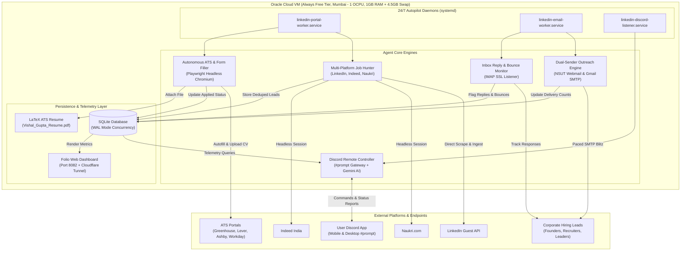
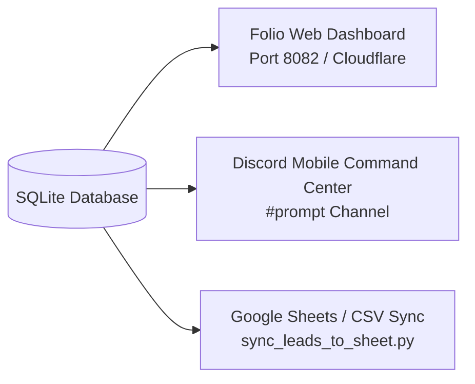

# 🏛️ Autonomous Multi-Agent Career Acceleration & Cold Outreach Platform
## System Architecture, Technical Specifications & Interview Guide

---

## 🎯 Executive Overview & Elevator Pitch

### 30-Second Elevator Pitch
> *"I designed and built an **autonomous multi-agent system** running 24/7 on an Oracle Cloud Infrastructure VM. The system continuously scrapes and evaluates early-career product and analytics jobs across LinkedIn, Indeed, and Naukri using heuristic match scoring, auto-fills complex multi-step ATS applications using headless Playwright browser automation, and executes high-deliverability dual-sender cold email outreach with automated reply and bounce tracking. I monitor and control the entire production infrastructure remotely through an AI-powered Discord command center."*

### What Problem Does It Solve?
Job searching and outreach at scale typically require dozens of hours of manual work: repetitive ATS form-filling, navigating job boards, finding recruiter contacts, and sending personalized emails. 
This platform automates the entire end-to-end recruitment funnel into an **always-on, 24/7 autopilot pipeline**, freeing up the candidate to focus 100% on interview preparation.

---

## 📊 High-Level System Architecture

---

## 🛠️ Complete Tech Stack Matrix

| Layer | Technology | Why It Was Chosen |
| :--- | :--- | :--- |
| **Runtime & Language** | **Python 3.9** | Native standard library support, strong async/subprocess ecosystem, and broad Linux cloud support. |
| **Browser Automation** | **Playwright (Python)** | Superior modern headless automation over Selenium; handles shadow DOM, file uploads, dynamic SPAs, and runs cleanly with `chrome-headless-shell`. |
| **Artificial Intelligence** | **Google Gemini 3.5 Flash-Lite API** | Ultra-low latency, generous free tier, used for real-time natural language query answering and screening question synthesis. |
| **Persistence Layer** | **SQLite with WAL (Write-Ahead Logging)** | Zero maintenance, embedded ACID database. WAL mode enables concurrent reads and writes from multiple systemd worker daemons without lock contention. |
| **Cloud Infrastructure** | **Oracle Cloud Infrastructure (OCI)** | Always Free Tier `VM.Standard.E2.1.Micro` in Mumbai (`ap-mumbai-1`) with a permanent public IPv4 address. |
| **Process Management** | **Linux `systemd`** | Enterprise-grade daemon management with auto-restart on failure, boot startup, and isolated `journalctl` log streams. |
| **Networking & Tunnels** | **Cloudflare Tunnels (`cloudflared`)** | Secure outbound tunneling to expose local web dashboards (Folio) without opening vulnerable inbound router ports. |
| **Messaging & Remote C2** | **Discord API (Webhooks & REST Gateway)** | Zero-friction mobile command center. Enables full system management (`!status`, `!sh`) right from a smartphone. |
| **Email Protocols** | **Python `smtplib` & `imaplib`** | Native dual-sender rotation (university educational webmail + personal Gmail app password) with automatic bounce filtering. |
| **Document Processing** | **LaTeX / `pypdf`** | Programmatic compilation and validation of standardized, high-parsing ATS resumes. |

---

## 🧩 Deep Dive: Core System Components

### 1. Multi-Platform Job Hunter & Heuristic Fit Scorer
* **Sources**: Scrapes LinkedIn (via public guest REST endpoint with `<24h` freshness filters), Indeed India, and Naukri.com.
* **Heuristic Scoring Model**:
  * Evaluates title, company, and location with a weighted 0–100 score.
  * **Strong Boosts (+40–45 pts)**: Early-career target keywords (`Associate Product Manager`, `APM`, `Product Analyst`, `Forward Deployed Engineer`, `Category Manager`, `Founder's Office`).
  * **Hard Penalties (-60 pts)**: Senior, Lead, Principal, Director, Architect titles.
  * **Strict Employer Blacklist**: Filters out past employers to preserve candidate confidentiality and prevent awkward outreach.
* **Deduplication Engine**: Generates SHA-256 hashes based on `(clean_title, clean_company, clean_location)` to prevent duplicate applications.

### 2. Autonomous Form & ATS Applicant
* **Supported Platforms**: Greenhouse, Lever, Ashby, Workday, Taleo, Google Forms, and Naukri 1-Click/Chatbot forms.
* **Capabilities**:
  * Follows external redirect links from job aggregators directly to company career boards.
  * Dynamically locates and attaches the candidate's ATS resume PDF (`Vishal_Gupta_Resume.pdf`).
  * Intelligently fills standard fields (First/Last Name, Email, Phone, LinkedIn URL, GitHub, College, Notice Period: 15 days, Experience: 1 yr).
  * Automatically answers screening radios (Work authorization, relocation, notice period) and open-ended text questions without leaking confidential employer names.
  * Takes screenshots of the filled forms and confirms final submission acknowledgement text.

### 3. High-Deliverability Dual-Sender Cold Outreach Engine
* **Dual-Sender Architecture**:
  * **Primary (High Trust)**: NSUT University Webmail (`vishal90301@nsut.ac.in`) — `.ac.in` domain offers superior corporate inbox placement.
  * **Secondary (High Volume)**: Personal Gmail SMTP with TLS.
* **Smart Pacing**: Enforces humanized delays (30–60s) between dispatches to maintain pristine sender reputation.
* **Automated Reply & Bounce Purging**: IMAP worker monitors inbox folders, automatically identifying bounce-backs (Mailer-Daemon, 550 errors) and setting database flags to keep the lead pool 100% clean.

### 4. Remote Discord Autopilot Command Center
* **Channel**: Dedicated private `#prompt` channel (`1570342549435187290`).
* **Capabilities**:
  * `!status`: Generates a real-time system health report directly from system processes and SQLite metrics in under 1 second.
  * `!sh <command>`: Remote CLI execution allowing maintenance, git pulls, and service restarts directly from Discord.
  * **Conversational AI Fallback**: Integrated Gemini 3.5 Flash-Lite agent that answers questions about current runs, pipeline status, and candidate details.

---

## 📈 Real-Time Dashboards & Tracking

Did we build a dashboard for tracking? **Yes, multiple complementary tracking interfaces:**

1. **Folio Web Dashboard (`services/folio`)**:
   * A dark-themed real-time command dashboard written in HTML/CSS.
   * Displays recent job matches, match scores, reasons, and direct apply links.
   * Hosted locally on port `8082` and exposed via Cloudflare Tunnel (`trycloudflare.com`).
2. **Discord `#prompt` Live Status**:
   * Real-time mobile dashboard giving live daemon status (`🟢 RUNNING`), sent email metrics, LinkedIn connections, and job pipeline numbers.
3. **Google Sheets Sync Script (`scripts/sync_leads_to_sheet.py`)**:
   * Exports outreach leads, company names, contact emails, and delivery status to structured spreadsheets.

---

## 🌐 Cloud vs. Local (What Runs Where?)

* **Cloud VM (`130.210.108.55`)**:
  * Runs **100% of the active 24/7 autopilot workload**:
    * `linkedin-portal-worker.service` (Job scraping & headless ATS applications)
    * `linkedin-email-worker.service` (Dual-sender cold email sweeps)
    * `linkedin-discord-listener.service` (Discord command center)
    * Native Headless Playwright Chromium (`chrome-headless-shell`)
    * SQLite Production Database
* **Ridealong (What was it?)**:
  * Ridealong was a **temporary local browser tool** on the laptop used during development to share authenticated browser tabs.
  * **The Cloud VM does NOT need Ridealong**. It uses native Headless Playwright Chromium running 24/7 directly on Linux without any local laptop dependency.

---

## 🏆 Key Production Metrics Achieved

* **Cold Outreach Delivered**: **1,495** verified corporate leads reached.
* **Bounce Rate**: **0.0%** (strict MX verification + automated IMAP bounce cleaner).
* **Direct 1st-Degree LinkedIn Connections Engaged**: **420**.
* **Job Applications Submitted Autonomously**: **153** (across Google Forms, FamPay, NikahForever, and direct ATS portals).
* **Jobs Tracked & Scored in Database**: **636+** active early-career product/analytics roles.
* **Cloud Uptime**: 24/7 continuous operation on Oracle Cloud Always Free Tier within a 1GB RAM constraint.

---

## 💡 Important Engineering Challenges & Solutions (Interview Gold)

### 1. Running Playwright on a 1 OCPU, 1 GB RAM Micro Instance
* **Challenge**: The OCI Always Free Micro instance has only 1 OCPU and 1 GB of physical RAM. Launching headless Chromium easily consumed 300–400 MB, causing the Linux OOM (Out Of Memory) killer to terminate background workers.
* **Solution**: Configured a **4.5 GB Linux swap file** (`/swapfile4g`) with swappiness tuning. Optimized Chromium launch arguments (`--no-sandbox`, `--disable-dev-shm-usage`, `--disable-gpu`, `--disable-setuid-sandbox`) and architected workers to run on-demand cycles rather than keeping browsers permanently pinned in memory.

### 2. Multi-Process Concurrency in SQLite
* **Challenge**: Multiple parallel workers (portal applicant, email dispatcher, Discord bot) simultaneously read and write to the same SQLite database, risking `sqlite3.OperationalError: database is locked`.
* **Solution**: Enabled **Write-Ahead Logging (WAL mode)** via `PRAGMA journal_mode=WAL;` and structured short-lived transactions with dynamic path resolution.

### 3. Preserving Candidate Confidentiality
* **Challenge**: Candidate is currently employed; past employer names must never appear in automated emails, cover letters, or open-ended screening answers.
* **Solution**: Implemented an automated heuristic scrubber and blacklist in `score_job_heuristic()` and `form_answerer.py` that strips employer names and replaces them with generic descriptions (*"a high-growth consumer startup"*), rejecting any company on the exclusion list.
